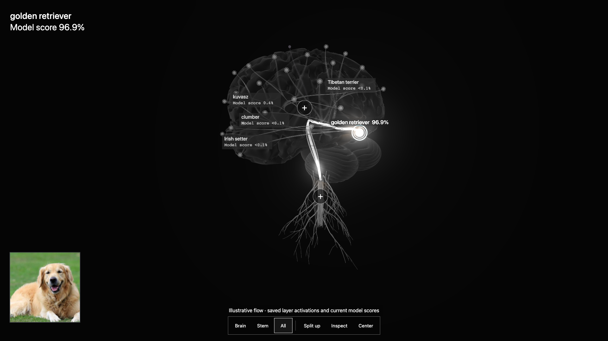

# Stark

> A solo project built at Knight Hacks IX (9–11 October 2026).

**Explore an image classifier. Change its internal features. Watch its answer change.**

## Try the demo

- **Judges / phone controller:** [Open the controller](https://64-177-50-154.sslip.io/controller?room=RENEW).
- **Presenter / main screen:** [Open the 3D display](https://64-177-50-154.sslip.io/display?room=RENEW).

Keep the display open while using a controller. The public HTTPS links work across networks; they do not depend on a judge sharing the presenter's Wi-Fi. The presenter should open the display first. Guests tap **Take control**; one guest drives at a time. Rotate the phone to landscape for more space, drag to turn, pinch to zoom, and tap an answer to explore it. Host access uses a separate private key, which is intentionally absent from this README.



## What Stark is

Stark makes image-model behavior explorable through an anatomical 3D brain and brainstem. The source image, model answers, feature activations, and heatmaps are linked to touch controls on phones and tablets. Its central demo is **Surgery / Steer**: scale internal feature channels and see the resulting model scores and top answer update.

The anatomy and animated flow are illustrative. They are not biological neurons or a literal picture of every model operation. The underlying scores, saved activations, channel interventions and available Grad-CAM maps come from the image models.

## How it works

1. A Python pipeline prepares image crops, model scores, a class hierarchy, Grad-CAM maps, layer activations and supported test data.
2. The Three.js display loads those assets and renders the brain, paths, image panel and contextual HUD.
3. A Node.js / Socket.io relay connects the display to guest and host controllers, enforcing control ownership and caching display state.
4. For ImageNet images, Steer computes changes on the display using saved last-layer activations and the model's dense head. The pooling and classification steps after that layer are recomputed from the edited channel scales; this does not retrain the model or rerun its earlier layers.

The controllers use plain ES modules, HTML and CSS, with no UI build step or remote fonts. The server supplies the Socket.io client.

## Features

- **Answer exploration:** ranked model scores, a cyan true-class ring, focused paths, and class-specific heatmap evidence when available.
- **Surgery / Steer:** channel sliders, a small channel-edit language, suggested interventions, reset, and a visible answer-change moment. Unknown class names remain annotations rather than invented model outputs.
- **Immersion:** extract and annotate nodes in a controller workspace, inspect real class scores, and apply suggested channel edits. Orbit and answer focus link to the shared display; node extraction and annotations are currently private to each controller.
- **Stability test:** repeated small input changes show how often each answer appears. The summary distinguishes the original answer from the most frequent answer across runs.
- **Adversarial pair:** compare the retriever with its perturbed counterpart and inspect the change amplified 50×.
- **Trunk interior:** inspect saved activation views from 49 selected ResNet50 layers. Full / Reduced controls change how many layers are drawn; they do not change the model's depth.
- **Chest X-rays:** independent findings scores from DenseNet121. Each score is 0–100% on its own; **not a diagnosis**.
- **Multi-device demo:** host gallery, playback, modes, glow controls, demo cues, guest handoff and reconnect feedback.

Modes are capability-gated. In the current asset set, stability data is available for retriever, tabby and wolf; the adversarial pair is retriever only. Steer and stability are disabled for medical images. A missing heatmap is identified explicitly.

## Running it locally

Requires **Node.js 20 or later**. Generated demo assets are included under `web/public/assets/`; Python is only needed to regenerate them.

```sh
git clone https://github.com/regulusaa/stark-knighthacks.git
cd stark-knighthacks
npm ci
PORT=3002 STARK_HOST_KEY=dev-only STARK_FIXED_ROOM=RENEW npm start
```

Open these in separate browser tabs/devices:

- Display: `http://localhost:3002/display?room=RENEW`
- Guest: `http://localhost:3002/controller?room=RENEW`
- Local host: `http://localhost:3002/controller?room=RENEW&role=host&key=dev-only`

`dev-only` is a local example, not a production credential. On another device, replace `localhost` with the server computer's LAN address and use the same network. For a public deployment, configure a private host key and `STARK_PUBLIC_URL` so generated QR codes use the public HTTPS address.

### Checks and assets

```sh
npm run smoke
node web/ui/dev/cx8-hud.verify.mjs http://localhost:3002
node web/ui/dev/immersion-target.verify.mjs http://localhost:3002
```

The browser checks require Playwright/Chromium to be installed. Run display tests against a local server: opening a test display against the fixed public room can replace the presenter's live screen.

To regenerate assets, use `python -m pipeline.run` in an environment with the pipeline's ML dependencies, model weights and WordNet data. This is separate from starting the web demo.

- [`contract/CONTRACT.md`](contract/CONTRACT.md): assets, events, permissions and Steer shapes.
- [`pipeline/`](pipeline/): precompute and review stages.
- [`server/`](server/): relay and [`deployment scripts`](server/deploy/).
- [`web/core/`](web/core/): renderer and display-side inference.
- [`web/ui/`](web/ui/): controllers, HUD and UI verification.

## AI usage

**AI usage.** This project was built during Knight Hacks with the help of generative AI coding tools, as permitted by MLH rules. Claude Code (Anthropic) was used for the Python precompute pipeline, the Node/Socket.io server, and the Three.js renderer. Codex (OpenAI) was used for the controller pages and HUD. I designed the architecture and the data contract between components, made the technical and design decisions, split the work between agents, and reviewed and integrated all generated code. Planning before the event was done with Claude (conversation only; no code was written before the event).

**Models used:** ResNet50 with ImageNet weights (Keras Applications); DenseNet121 chest X-ray model from torchxrayvision. Stark is not a wrapper around an LLM or API: it visualizes the internal behavior of image models.

**Prior work:** the phone/tablet controller design was inspired by an earlier personal project of mine; all code here was written during the event.

## Credits

Models and libraries include Keras Applications / ResNet50, torchxrayvision / DenseNet121, Three.js, Socket.io, Express, NLTK WordNet, and Playwright for browser verification. Refer to their upstream projects for their respective licenses.

Recorded image attribution is in [`credits.txt`](credits.txt). The pneumonia X-ray is credited there to Malvinder S Parmar / BMC Infectious Diseases via Wikimedia Commons (CC BY 2.0). Attribution for the supplied normal X-ray is still pending in that file; this README does not claim a license for it.
